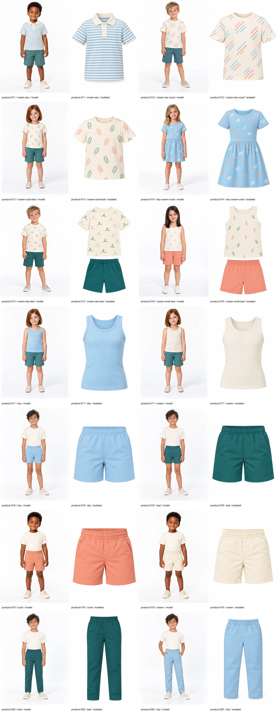

# Brincadeira photography — issue #68

Revision: `issue-68-catalog-v1`. Ten products, fourteen colorways and 28 approved photographs. Two product-020 / sky photographs accepted for issue #68; 26 retained photographs preserve their prior approvals.

The user replied “yes” to the exact reviewed pair. [Acceptance](catalog-refresh-68/approval.json) records evidence and all original/export hashes. [Historical batch](catalog-refresh-68/before-integration/brincadeira-manifest.json) and all prior originals/approvals remain retained. The [immutable review](catalog-refresh-68/review.md) records the audit and discarded attempts.

| Product | Colorway | Worn | Isolated | Approval source |
| --- | --- | --- | --- | --- |
| product-011 | cream-sky | [Model](../../public/images/catalog/product-011-cream-sky-model-v1.webp) | [Isolated](../../public/images/catalog/product-011-cream-sky-isolated-v1.webp) | docs/content/polo-approval.json |
| product-012 | cream-sky-coral | [Model](../../public/images/catalog/product-012-cream-sky-coral-model-v1.webp) | [Isolated](../../public/images/catalog/product-012-cream-sky-coral-isolated-v1.webp) | docs/content/brincadeira-approval.json |
| product-013 | cream-coral-teal | [Model](../../public/images/catalog/product-013-cream-coral-teal-model-v2.webp) | [Isolated](../../public/images/catalog/product-013-cream-coral-teal-isolated-v1.webp) | docs/content/brincadeira-approval.json |
| product-014 | sky-cream-coral | [Model](../../public/images/catalog/product-014-sky-cream-coral-model-v2.webp) | [Isolated](../../public/images/catalog/product-014-sky-cream-coral-isolated-v1.webp) | docs/content/brincadeira-approval.json |
| product-015 | cream-sky-teal | [Model](../../public/images/catalog/product-015-cream-sky-teal-model-v4.webp) | [Isolated](../../public/images/catalog/product-015-cream-sky-teal-isolated-v1.webp) | docs/content/brincadeira-approval.json |
| product-016 | cream-coral-teal | [Model](../../public/images/catalog/product-016-cream-coral-teal-model-v2.webp) | [Isolated](../../public/images/catalog/product-016-cream-coral-teal-isolated-v1.webp) | docs/content/brincadeira-approval.json |
| product-017 | sky | [Model](../../public/images/catalog/product-017-sky-model-v1.webp) | [Isolated](../../public/images/catalog/product-017-sky-isolated-v1.webp) | docs/content/brincadeira-approval.json |
| product-017 | cream | [Model](../../public/images/catalog/product-017-cream-model-v1.webp) | [Isolated](../../public/images/catalog/product-017-cream-isolated-v1.webp) | docs/content/brincadeira-approval.json |
| product-018 | sky | [Model](../../public/images/catalog/product-018-sky-model-v2.webp) | [Isolated](../../public/images/catalog/product-018-sky-isolated-v1.webp) | docs/content/brincadeira-approval.json |
| product-018 | teal | [Model](../../public/images/catalog/product-018-teal-model-v1.webp) | [Isolated](../../public/images/catalog/product-018-teal-isolated-v1.webp) | docs/content/brincadeira-approval.json |
| product-019 | coral | [Model](../../public/images/catalog/product-019-coral-model-v1.webp) | [Isolated](../../public/images/catalog/product-019-coral-isolated-v1.webp) | docs/content/brincadeira-approval.json |
| product-019 | cream | [Model](../../public/images/catalog/product-019-cream-model-v1.webp) | [Isolated](../../public/images/catalog/product-019-cream-isolated-v1.webp) | docs/content/brincadeira-approval.json |
| product-020 | teal | [Model](../../public/images/catalog/product-020-teal-model-v2.webp) | [Isolated](../../public/images/catalog/product-020-teal-isolated-v1.webp) | docs/content/brincadeira-approval.json |
| product-020 | sky | [Model](../../public/images/catalog-pose-variants/product-020-sky-hands-in-pockets-v1.webp) | [Isolated](../../public/images/catalog-refresh-68/product-020-sky-isolated-refresh68-v3.webp) | docs/content/catalog-refresh-68/approval.json |

## Approved pose update

Revision: `catalog-pose-variants-v1-brincadeira`. [User approval](catalog-pose-variants/approval.json) replaces only this collection's selected model photographs. Current assets are listed in the collection manifest; previous review and manifests are retained in [the archive](catalog-pose-variants/before-integration/).
